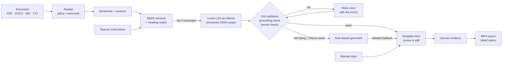

# Reelingo

Make short vertical videos (9:16, 1080×1920) for Instagram Reels, TikTok and YouTube Shorts from language-lesson templates. Pick a template, fill in a form (by hand, or automatically from an uploaded lesson), watch the live preview, and download an MP4.

Reelingo is a portfolio project that demonstrates **hybrid RAG with a local LLM**. BM25 retrieval over the teacher's document feeds a small model served by [Ollama](https://ollama.com). Its output is validated with Zod and checked against the source sentences programmatically, and a deterministic rule-based generator takes over whenever the model fails. Everything runs on the user's computer: no account, no API key, no paid service, and the document never leaves the machine.

The name is a placeholder: change `APP_NAME` in [src/config.ts](src/config.ts), the `<title>` in [index.html](index.html), and the `name` in `package.json`.

## Features

- **Four templates**: Quiz, Top 5 ranking, True or False, Word of the day.
- **Live preview** in a phone frame with play, pause, scrub and a toggle that shows the platform safe zones.
- **Real MP4 export** (H.264 + AAC) via WebCodecs and `mp4-muxer`. Frames are rendered offline, so a 7-second clip renders in about 5 seconds on a laptop. Browsers without WebCodecs fall back to `MediaRecorder` (real time, usually WebM), and the export dialog says so.
- **Audio**:
  - Synthesised sound effects (tick, pop, whoosh, correct and wrong chimes, reveal), so there's nothing to license.
  - Uploads for background music (MP3/WAV, 10 MB) and a voiceover.
  - Music loops if it's shorter than the video, fades in and out, and is lowered while the voiceover plays.
  - Mixed with `OfflineAudioContext` for export.
- **Themes**: six built-in themes, plus a custom accent colour.
- **Branding**: a watermark or handle and a logo (PNG, JPG, WebP or SVG), each placeable in any corner.
- **Languages**:
  - Full Unicode text rendering with bundled Inter and Cairo fonts (Latin, accented French, Arabic, IPA).
  - Right-to-left layout for Arabic, including mixed Arabic and English text.
  - The UI is available in English, French and Arabic, with an RTL interface for Arabic.
- **`*Star*` markup**: wrap a word in `*stars*` to colour it on screen.
- **Projects** are saved in IndexedDB, with thumbnails. Once a project has been saved, it autosaves.
- **Two ways to fill a template:**
  - **Manual:** type the content into the form.
  - **From a document:** upload a PDF, Word (.docx), Markdown or TXT lesson and give short instructions ("5 quiz questions on the past tense"). The form fills itself with content written by a local model from the retrieved passages, with the supporting sentence shown under each item. Review or edit it, then generate the video.

## Getting started

Requires Node 20+.

```bash
npm install
npm run dev        # http://localhost:5173
```

| Script | What it does |
| --- | --- |
| `npm run dev` | Dev server |
| `npm run build` | Type-check and build static files into `dist/` (deploy anywhere) |
| `npm run check` | Type-check, lint (no `any`) and unit tests |
| `npm test` | Unit tests plus a smoke test that renders frames of every format in Node |
| `npm run sheet -- <formatId> <themeId> out.png ['{json data}']` | Renders a strip of 8 frames to PNG, handy for checking timing and layout |
| `npm run e2e:export -- [formatId\|all] [outDir]` | Exports each format in a real Chrome, reports render time, and validates the MP4 (H.264 track, audio track, duration, non-silent audio) |
| `npm run e2e:document -- [outDir]` | Document path in Chrome with Ollama **mocked**: once with grounded model output (the form fills from the model) and once with an invented sentence (rule-based fallback with a note). Both must export an MP4 |
| `npm run eval` | Evaluation harness: rule-based vs each local model on `eval/docs` (see [Evaluation](#evaluation)) |
| `npm run eval:ratings -- <filled.csv…>` | Averages teacher ratings (relevance and difficulty, 1–5) from copies of `eval/ratings-template.csv` |
| `npm run llm:demo -- [formatId] [model] [instructions] [file.md]` | Runs the document path in Node against your Ollama and logs every model call |
| `npm run engine:demo -- [file.md\|file.txt] [instructions]` | Runs the rule-based engine alone and prints the videos |
| `npm run lexicon` | Rebuilds the English lexicon (runs automatically before `dev`, `build` and `test`) |
| `npm run e2e:ui -- [outDir]` | Clicks through the app in Chrome (home, editors, export, save, uploads, Arabic UI, mobile) and saves screenshots |

The `e2e:*` scripts need the dev server running and a local Chrome or Edge. Set `CHROME_PATH` if yours isn't found automatically. Unit tests never call a real model.

### Local AI setup (optional, for the document path)

The app works without Ollama: the document path then uses the rule-based generator and says so.

1. Install Ollama from [ollama.com](https://ollama.com) and start it (open the app, or run `ollama serve`).
2. Pull a generation model:
   ```bash
   ollama pull qwen2.5:3b      # default
   ollama pull qwen2.5:1.5b    # lighter option
   ```
   `llama3.2:1b` is supported too (used for comparison). `tinyllama:1.1b` is listed as not recommended. Embedding models such as `nomic-embed-text` are hidden from the model list. Any other model you install (for example `qwen2.5:7b`) appears automatically. Defaults live in [src/config.ts](src/config.ts) (`OLLAMA`).
3. In **Settings → Local AI**, check the address (default `http://localhost:11434`), choose the model and the learners' CEFR level, then click **Test connection**.

**CORS.** Ollama accepts requests from `localhost` pages by default, so `npm run dev` works without any change. If you serve the app from another origin, allow it and restart Ollama:

| OS | Command |
| --- | --- |
| Windows | `setx OLLAMA_ORIGINS "https://your-site.example"`, then quit Ollama from the tray and start it again |
| macOS | `launchctl setenv OLLAMA_ORIGINS "https://your-site.example"`, then restart the Ollama app |
| Linux | `sudo systemctl edit ollama.service`, add `[Service]` and `Environment="OLLAMA_ORIGINS=https://your-site.example"`, then `sudo systemctl daemon-reload && sudo systemctl restart ollama` |

The app shows these commands (with your actual origin) when it detects a CORS block, and shows the exact `ollama pull …` command when the model is missing.

## How it works



```
src/
  config.ts          video size, fps, platform safe zone
  formats/           one folder per format (auto-discovered)
    registry.ts      import.meta.glob('./*/index.ts')
    types.ts         FormatModule interface + defineFormat()
    kit.ts           shared pieces (tag pill, progress line, timing helpers)
    quiz/ top5/ truefalse/ wordofday/ starter/
  scene/             drawing toolkit: text (wrap, RTL, markup), easing, timeline,
                     countdown ring, progress bar, confetti, shapes, backgrounds
  themes/            the 6 themes + accent override
  render/            renderFrame() (background → format → branding), thumbnails
  audio/             synthesised SFX, mixer (live + offline), preview controller
  export/            WebCodecs + mp4-muxer exporter, MediaRecorder fallback
  storage/           IndexedDB: projects and uploaded media
  state/             zustand stores (editor, settings, document input)
  engine/            reader, text processing, BM25, analysis, rule-based generators (Web Worker)
  ai/                document path: ContentGenerator interface, retrieval, Ollama client,
                     prompts, schemas, checks, OllamaGenerator, RuleBasedGenerator, MockGenerator, pipeline
  i18n/              en (source of truth), fr, ar
  app/, components/  React UI
```

**One renderer.** Every frame is `render(ctx, data, t, theme)` on a 1080×1920 canvas, and it is a pure function of `t`. The preview calls it from `requestAnimationFrame` on a scaled canvas. Export calls it for `t = i / 30` on an `OffscreenCanvas` and hands each frame to `VideoEncoder`. Preview and export therefore use the same drawing code at the same timestamps. Confetti and noise use a seeded PRNG, so any frame can be drawn on its own (needed for scrubbing).

**Timelines.** Each format builds a `Timeline` of named segments (`intro`, `question`, `countdown`, `reveal`…) from its data. `duration()`, `render()` and `cues()` all read the same timeline, so the video length, the animation and the sound effects can't drift apart.

**Text.** `scene/text.ts` handles the text layout:
- It parses `*star*` markup and wraps words to the line width.
- It shrinks text to fit a box, and prefers a smaller size over breaking a word.
- It supports a typewriter reveal.
- It orders words with a simplified Unicode bidi algorithm: paragraph direction comes from the first strong character, digits and punctuation follow their neighbours, and paired brackets resolve together.

The browser shapes each word (Arabic joining, accents), so drawing word by word stays correct.

## Adding a new format

Add one folder under `src/formats/`. Nothing else needs to change: the registry picks it up, it appears on the home grid, and the existing tests run it automatically (defaults validate against the schema, the duration is finite, cues fall inside the video, and a frame renders in Node).

```ts
// src/formats/flashcard/index.ts
import { z } from 'zod';
import { buildTimeline, drawText, fitText, riseIn, withTransform } from '@/scene';
import { SAFE, SAFE_WIDTH } from '@/config';
import { CX, drawTimeline } from '../kit';
import { defineFormat } from '../types';
import { FlashcardForm } from './Form';

export const flashcardSchema = z.object({
  front: z.string().trim().min(1).max(60),
  back: z.string().trim().min(1).max(120),
});
export type FlashcardData = z.infer<typeof flashcardSchema>;

const timeline = (d: FlashcardData) =>
  buildTimeline([
    { id: 'front', duration: 2.5 },
    { id: 'back', duration: 3 },
  ]);

export default defineFormat<FlashcardData>({
  id: 'flashcard',                    // used in URLs and saved projects
  order: 5,                           // position on the home grid
  title: { en: 'Flashcard', fr: 'Carte mémoire', ar: 'بطاقة' },
  description: { en: 'A word on the front, its meaning on the back.' },
  schema: flashcardSchema,
  defaults: { front: 'to *nail* it', back: 'to do something perfectly' },
  Form: FlashcardForm,                // receives { value, onChange, errors }
  duration: (d) => timeline(d).total,
  render(ctx, d, t, theme) {          // 1080×1920 logical pixels
    const tl = timeline(d);
    const front = fitText(ctx, d.front, { maxWidth: SAFE_WIDTH, maxHeight: 400, maxSize: 120 });
    drawText(ctx, front, { x: CX, y: SAFE.top + 200, align: 'center', color: theme.text, emphColor: theme.accent });
    const back = fitText(ctx, d.back, { maxWidth: SAFE_WIDTH, maxHeight: 400, maxSize: 64, weight: 400 });
    withTransform(ctx, riseIn(tl.p('back', t)), () =>
      drawText(ctx, back, { x: CX, y: SAFE.top + 700, align: 'center', color: theme.textMuted }),
    );
    drawTimeline(ctx, theme, t, tl.total);
  },
  cues: (d) => [{ t: timeline(d).get('back').start, sfx: 'pop' }], // optional
});
```

Tips:
- Keep important content inside `SAFE` (the area the Reels/TikTok/Shorts overlays don't cover). The preview's "Safe zones" toggle shows it.
- Build forms from the controls in `src/components/ui/` (`Field`, `TextInput`, `TextArea`, `Segmented`, `Toggle`, `ListRow`, `AddButton`) and put form labels in a local `messages` object read with `useMessages()`.
- Use `PaceField` and `paceSchema` if your format has a "time per card" setting.
- `npm run sheet -- flashcard ink out.png` renders frames so you can check the timing.
- `src/formats/starter/` is a small, hidden example format to copy from.

## Document path: retrieval-augmented generation with a local LLM

All of this code is in [src/ai/](src/ai/), behind one interface:

```ts
interface ContentGenerator {
  generate(request: GenerationRequest, onItem?: (item: GeneratedItem) => void): Promise<GenerationOutcome>;
}
```

Three implementations sit behind that interface:
- `OllamaGenerator`, the local LLM, which is the main generator,
- `RuleBasedGenerator`, which wraps the deterministic engine described below and acts as the automatic fallback,
- `MockGenerator`, used in tests.

`runGeneration()` (in [pipeline.ts](src/ai/pipeline.ts)) asks the primary generator first, then fills every missing item from the fallback, recording *why* it fell back.

**1. Retrieval** ([retrieval.ts](src/ai/retrieval.ts)).
- The instructions are split into a count and a topic: "5 quiz questions on the past tense" becomes 5 items about "past tense". A number after "top" counts as part of the topic.
- A heading that contains every topic word selects its section, with complete sentences first. Otherwise sentences are ranked with BM25, with headings counted as context.
- If only a few sentences match, their neighbours and the document's key-term sentences are added.
- At most `OLLAMA.generation.maxPassages` (6) passages are sent per request. The whole document is never sent.

**2. Generation** ([prompts.ts](src/ai/prompts.ts), [ollamaGenerator.ts](src/ai/ollamaGenerator.ts)).
- `POST /api/chat` with `stream: false`, temperature 0.2, and Ollama's **structured outputs**. The `format` field carries a JSON Schema derived from a Zod schema with `z.toJSONSchema`.
- The model writes only the content fields. Labels, pace and IPA are filled in by the app, and IPA always comes from the CMU dictionary, never from the model.
- Requests are made in batches of 1–3 items, which suits small models. Each later batch prefers passages that haven't been used yet.

**3. Prompt design** for small models. Prompts are written in English, even for French or Arabic content, and each has short, concrete rules and one few-shot example per format.
- **Grounding:** "Use ONLY the numbered passages. Copy the supporting sentence EXACTLY. If the passages are not enough, return fewer items."
- **Output:** the output language is stated explicitly, with a right-to-left instruction for Arabic, and the CEFR level is included.
- **Per format:**
  - Quiz: exactly one correct option, and wrong options with the same part of speech and form.
  - True/False: false statements change one detail (who, when, where, how many) instead of just adding "not".
  - Word of the day: a new example sentence.
  - Top 5: ranked for the instructions.
- **Schema order:** the JSON Schema puts `supporting_sentence` before `content`, so the model commits to its evidence first.

**4. Guardrails** ([checks.ts](src/ai/checks.ts)). Nothing the model returns is trusted:
1. Strip code fences and parse the JSON. Validate it with the format's model schema, then with the template's own Zod schema.
2. **Grounding check.** The `supporting_sentence` must appear in the retrieved passages, compared with normalised whitespace, case and quotes, and with any "[2]" number removed. An item citing an invented sentence is never shown.
3. **Format checks:**
   - Quiz: exactly one correct option, no duplicate options, the answer is the missing word or is supported by the passages, and no wrong option also fits the gap.
   - True/False: a true statement matches its sentence, a false one changes a detail, and the explanation cites the sentence.
   - Word of the day: the word appears in the cited sentence.
   - Top 5: every item comes from the passages.
   - All formats: the output language matches the document.
4. **Retry and fallback:** one retry, with the exact errors included in the prompt. Then the item falls back to the rule-based generator, labelled in the UI ("Made by the rule-based engine instead of the local AI (the model's answer was not supported by the document)").
5. **Environment errors** (Ollama not running, CORS, model missing, timeout) also fall back, and the UI shows the fix.

### The rule-based generator (fallback)

The fallback is the deterministic engine in [src/engine/](src/engine/): classic information retrieval and rule-based question generation, with no machine learning, running in a Web Worker.

**1. Reading** ([src/engine/reader.ts](src/engine/reader.ts)). The file is turned into structured blocks: headings, paragraphs, list items, table rows and bold terms.
- **PDF:** text is read with `pdf.js`. Lines are regrouped into paragraphs, larger or all-caps lines become headings, and "term – meaning" lines are kept as separate entries.
- **Word (.docx):** converted to HTML with `mammoth`, which keeps headings, lists, tables and bold text.
- **Markdown and plain text:** parsed directly.

**2. Text processing** ([src/engine/text.ts](src/engine/text.ts)). The engine works out:
- the document's language (English, French or Arabic), from the script and common words,
- sentence boundaries, without breaking on abbreviations,
- tokens and stopwords,
- light stems, so inflected forms match ("carottes" ~ "carotte", "deadlines" ~ "deadline", "المكتبة" ~ "مكتبة").

**3. Retrieval** ([src/engine/search.ts](src/engine/search.ts), `computeFocus`). The optional instructions select part of the document:
- a heading containing every instruction word ("Unit 3") selects that section,
- otherwise passages are ranked with **BM25**, the ranking function used by classic search engines.

**4. Analysis** ([src/engine/analyze.ts](src/engine/analyze.ts)):
- **Glossary.** The document's own definitions and translations are found in vocabulary tables (including column roles such as Meaning or Translation), in "term – meaning" / "term: meaning" lines, in "X means Y" / "X signifie Y" / "X تعني Y" sentences, and in bold terms.
- **Key terms.**
  - English is tagged with the rule-based NLP library `compromise`, for part of speech, base forms and phrasal verbs.
  - Terms are ranked by how often they occur in the document compared with everyday English (SUBTLEX word frequency).
  - French and Arabic use the term's spread across the document (TF-IDF) instead.
  - Glossary entries, bold terms and words in headings get a boost, and names are filtered out.
- **Definitions.** The document's own definition comes first. For English words it doesn't define, the app falls back to Princeton WordNet. IPA comes from the CMU Pronouncing Dictionary, converted from ARPAbet.

**5. Generation** ([src/engine/generators.ts](src/engine/generators.ts)). Every output is validated against the template's Zod schema.
- **Quiz:** two kinds, alternated.
  - **Fill the gap:** a real sentence from the document with a key word blanked out. The wrong answers are other key words from the document with the same part of speech and grammatical form (plural, past tense…). For English verbs they're conjugated to match.
  - **What does X mean?** The wrong answers are other definitions from the same source.
- **True or False:** a true statement is a sentence from the document. A false one is a document sentence that has been negated (English), or had a key word swapped for another, or a term paired with the wrong definition. The explanation quotes the original sentence.
- **Word of the day:** word, IPA, part of speech, definition, translation from the glossary, and an example sentence from the document with the word highlighted.
- **Top 5:** the five strongest terms of a section, each with its meaning.

Labels and explanations are written in the document's language. If the document doesn't have enough material for a template, the app says so instead of inventing content.

**Lexicon data.** `scripts/build-lexicon.mjs` builds three files into `public/lexicon/` from npm packages: word frequencies (SUBTLEX-US, 0.5 MB), IPA (CMU Pronouncing Dictionary, 1.1 MB) and definitions (Princeton WordNet 3.1, 5.2 MB). The script runs automatically before `dev`, `build` and `test`, and the output is git-ignored. The files are loaded only for English documents.

Attribution: WordNet 3.1 © Princeton University (WordNet licence); CMU Pronouncing Dictionary © Carnegie Mellon University (BSD); SUBTLEX-US word frequencies (Brysbaert & New); `compromise` (MIT); `pdf.js` (Apache-2.0); `mammoth` (BSD-2); `stopwords-iso` (MIT).

## Evaluation

`npm run eval` runs the document path on `eval/docs/` (5 English, 2 French and 1 Arabic lessons), with two hand-labelled instruction sets per document in [eval/ground-truth.json](eval/ground-truth.json). That's 16 instruction sets covering all four templates. For each one it records:
- **Retrieval:** capped recall@3 (relevant sentences in the top 3 ÷ min(3, number of relevant)) and MRR, against the labelled sentences.
- **Generation**, for the rule-based generator (A) and for each model (B) on the same passages:
  - the schema-valid rate of raw model items,
  - the share of requested items that are grounded on the first try and after the retry,
  - the fallback rate,
  - distractor quality: same part of speech as the answer (via `compromise`, English only), and no duplicate of the answer,
  - seconds per item, including retries.

Results are printed as tables and saved to `eval/results.json`. `eval/ratings-template.csv` lists every generated item for teachers to rate (relevance and difficulty, 1–5); `npm run eval:ratings` averages filled copies.

### Results

One run on a CPU-only laptop (8 GB RAM, no GPU), temperature 0.2, batches of up to 2 items, 6 passages per request, 1 retry. The samples are small (16 instruction sets, 29 requested items per generator), so read the numbers as indicative rather than definitive.

**Retrieval** (BM25 + heading match; the same for every generator):

| Language | Instruction sets | Recall@3 | MRR |
| --- | ---: | ---: | ---: |
| all | 16 | 0.84 | 0.97 |
| English | 10 | 0.78 | 0.95 |
| French | 4 | 0.92 | 1.00 |
| Arabic | 2 | 1.00 | 1.00 |

**Generation:**

| Generator | Items | Schema-valid (raw) | Grounded, 1st try | Grounded after retry | Fallback | Distractor POS match (en) | Distractor ≠ answer | s / item |
| --- | ---: | ---: | ---: | ---: | ---: | ---: | ---: | ---: |
| rule-based | 29 | 100% | 100% | — | — | 71% (n=7) | 100% | < 0.1 |
| qwen2.5:3b | 29 | 100% | 59% | 72% | 28% | 55% (n=11) | 100% | 18.6 |
| qwen2.5:1.5b | 29 | 91% | 41% | 55% | 45% | — | 100% | 18.4 |
| llama3.2:1b | 29 | 100% | 24% | 38% | 62% | — | — | 12.5 |

"Grounded" means the item passed every check: Zod, the exact-sentence grounding check and the format checks. Every item the model didn't deliver was filled by the rule-based generator, so each run still returned 29 usable items.

**Grounded after retry, by language:**

| Generator | English | French | Arabic |
| --- | ---: | ---: | ---: |
| qwen2.5:3b | 76% | 63% | 75% |
| qwen2.5:1.5b | 76% | 38% | 0% |
| llama3.2:1b | 53% | 25% | 0% |

### Discussion

- **Retrieval is strong on structured lessons and weak on paraphrase.** A topic that matches a heading ("futur proche", "countable and uncountable nouns") pulls in the right section, and MRR is 0.97 overall. Lexical matching misses sentences that use other words: "irregular verbs" doesn't retrieve "Go becomes went, see becomes saw…". That gap is the main argument for the optional hybrid retrieval (embeddings plus BM25).
- **Only qwen2.5:3b is good enough to be the main generator** on this hardware. It delivered 72% of items after the retry. The 1–1.5B models failed mostly on grounding: they paraphrased or merged sentences instead of copying the supporting sentence, cited the wrong passage, or (llama3.2:1b) produced no acceptable multiple-choice question at all. For those models the rule-based fallback did most of the work.
- **The retry pays off.** Including the exact validation errors in the prompt raised acceptance by 13–14 points for every model.
- **French and Arabic are where small models are weakest.** qwen2.5:3b held up reasonably (63% French, 75% Arabic, though Arabic has only 4 items). The smaller models fell to 25–38% in French and 0% in Arabic.
- **Stricter checks cost acceptance, deliberately.** A first run with fewer checks accepted 86% of qwen2.5:3b items. Reading the outputs showed near-duplicate Arabic options ("كتابًا" / "كتاباً"), a "false" statement that copied another passage verbatim, leaked "<<1>>" markers, and English definitions for French words. Adding checks for those brought acceptance to 72%. The numbers above are from the stricter version.
- **What the checks still don't catch.** A correct paraphrase labelled "false". A wrong answer marked correct in a non-gap question (llama3.2:1b marked "regular" as the answer to "What is a common verb that is irregular?"). Weak but grounded Top 5 items ("three", "o'clock"). Wrong part-of-speech labels. This is why results fill the form for review instead of going straight to video.
- **The model versus the rules.** The rule-based generator is always grounded and instant, but its questions are mechanical. qwen2.5:3b writes more natural questions ("Which of the following is a countable noun?", French and Arabic gap questions), at about 19 s per item on a CPU, and still needs the guardrails and the fallback. Distractor part-of-speech agreement was checked on very few items (7–11), too few to rank the generators.
- **Teacher ratings** (relevance and difficulty) are prepared in `eval/ratings-template.csv` but haven't been collected yet, so no claim is made here about pedagogical quality.

## Browser support

| | Preview | MP4 export |
| --- | --- | --- |
| Chrome / Edge (desktop and Android) | ✅ | ✅ WebCodecs, H.264 + AAC |
| Safari 17+ | ✅ | ✅ WebCodecs (audio codec support varies; falls back to Opus or silent with a warning) |
| Firefox | ✅ | WebCodecs where H.264 encoding is available, otherwise the real-time WebM fallback |

## Known limitations

- **Bidi is simplified.** Mixed Arabic and English text is handled for headline-length content (word order, punctuation, brackets, numbers). Deeply nested embeddings or explicit bidi control characters are not supported.
- **Arabic typewriter reveal** shows letters one at a time, so a letter's joined form can change as the next letter appears. Other animations are unaffected.
- **Fixed output**: 30 fps, 1080×1920, about 8 Mbps. There is no in-app trimming of music or voiceover: music starts at its beginning, and a voiceover longer than the video is cut (the app warns you).
- **The fallback recorder** (no WebCodecs) records in real time, needs the tab to stay visible, and usually produces WebM. Instagram and TikTok accept WebM inconsistently, so use Chrome or Edge for MP4.
- **Uploaded media isn't cleaned up.** Removing a music track or logo from the editor doesn't delete the file from IndexedDB, because saved projects may still use it. Clearing site data removes everything.
- **Storage is per browser.** Projects don't sync between devices or browsers. There is no import/export of projects yet.
- **Safe zones** are a general approximation of the Reels/TikTok/Shorts overlays. Each app's UI changes over time.
- **Preview audio** is scheduled against the Web Audio clock while the picture follows `requestAnimationFrame`. They can drift by a few milliseconds while you're editing, but exports are exact.
- **Local LLM (document path)**:
  - **Small models make mistakes.** The guardrails catch invented sources and malformed answers, but not every subtle error: a grammatically correct but odd distractor, or a debatable "false" statement can still get through. Teachers should review each item before generating the video, which is why results fill the form rather than going straight to video.
  - **Grounding is checked at the sentence level.** It proves the item cites a real sentence, not that every word of the question follows from it. Format checks narrow the gap, but they're heuristics.
  - **Speed:** on a CPU-only laptop, one item takes tens of seconds with qwen2.5:3b (see the evaluation table). A GPU makes it much faster.
  - **Retrieval is lexical** (BM25). Paraphrased topics ("irregular verbs" vs "go becomes went") can miss relevant sentences. Hybrid retrieval with embeddings (`nomic-embed-text` is reserved for it in the config) is the planned next step.
  - **Ollama runs separately.** It has to be installed and running; without it the app uses the rule-based fallback.
- **Rule-based fallback**:
  - **Generated content is mechanical.** Questions come from the document's real sentences, and distractors are other words from the document, so read each video before posting.
  - **English gets the full toolset:** grammar tagging, dictionary definitions, IPA and verb conjugation. French and Arabic get keywords, retrieval, glossary definitions, fill-the-gap and swaps, but no dictionary fallback, IPA or part of speech unless the document provides them.
  - **Scanned PDFs** (images without a text layer) can't be read, because there's no OCR.
  - **Layout detection is heuristic.** Unusual PDF layouts (multi-column pages, text in images) can produce odd paragraphs.
- **Fonts**: video text uses Inter and Cairo, so scripts they don't cover (for example CJK) fall back to system fonts and may look different on another device.
